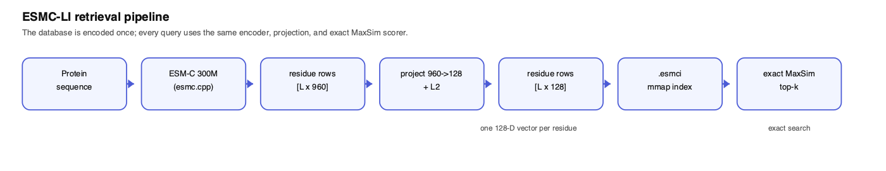
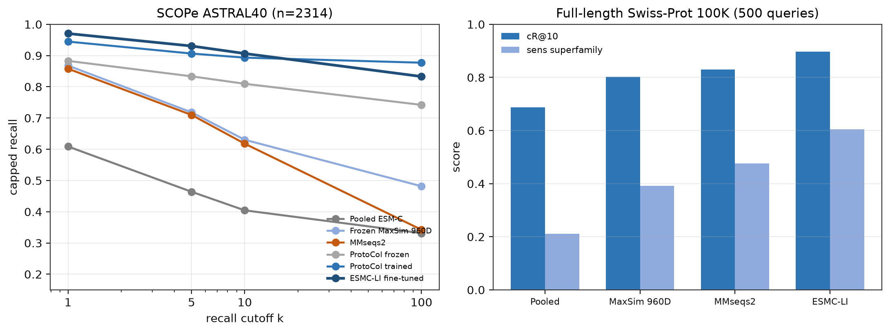
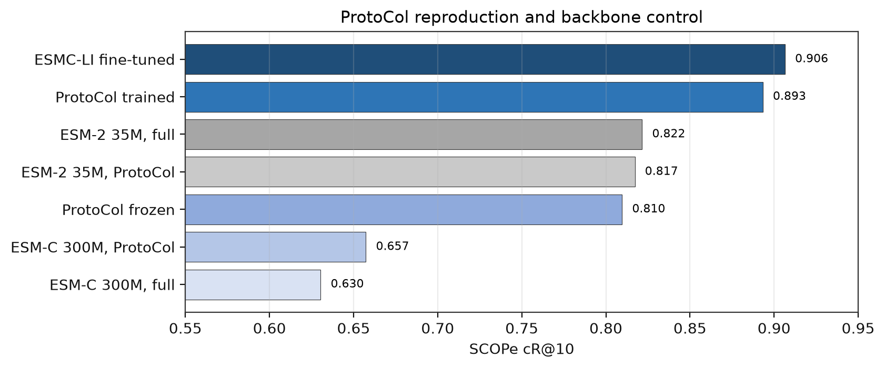
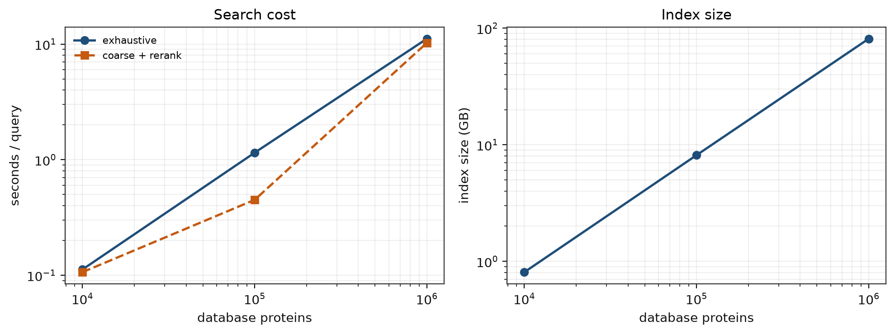

# ESMC-LI

**Fast, local protein retrieval with ESM-C residue embeddings and late interaction (MaxSim).**

[](https://pypi.org/project/esmc-li/)
[](https://pypi.org/project/esmc-li/)
[](https://github.com/AnanyaP-WDW/esmc-li/actions/workflows/ci.yml)
[](https://github.com/AnanyaP-WDW/esmc-li/blob/main/LICENSE)

ESMC-LI is a pip-installable protein retrieval engine for local and offline
search. It encodes proteins with **ESM-C 300M**, projects every residue into a
128-dimensional vector, and ranks candidates with **exact MaxSim** late
interaction. The index is a single memory-mapped `.esmci` file; inference runs
through [`esmc.cpp`](https://github.com/AnanyaP-WDW/esmc.cpp).

Late interaction follows ColBERT; the protein-specific model idea was
introduced by **ProtoCol** ([arXiv:2605.29158](https://arxiv.org/abs/2605.29158)).
ESMC-LI focuses on the practical index, full-length evaluation, and a
reproducible local package.

**Paper:** [Scaling Late-Interaction Protein Retrieval](https://github.com/AnanyaP-WDW/esmc-li/blob/main/paper/main.md) ·
**API:** [docs/api.md](https://github.com/AnanyaP-WDW/esmc-li/blob/main/docs/api.md) ·
**Model:** [AnanyaPathak/esmc-li-300m-homology-v1](https://huggingface.co/AnanyaPathak/esmc-li-300m-homology-v1) ·
**Indexes:** [AnanyaPathak/esmc-li-indexes](https://huggingface.co/datasets/AnanyaPathak/esmc-li-indexes)

## At a glance

| | |
|---|---|
| Search | Exact MaxSim over residue vectors; no ANN approximation |
| Backbone | ESM-C 300M, 960-dimensional residue embeddings |
| Projection | 128-dimensional, L2-normalized rows |
| SCOPe ASTRAL40 cR@10 | **0.9065** (fine-tuned) vs 0.8933 reproduced ProtoCol |
| Full-length 100K cR@10 | **0.8974** vs 0.8304 MMseqs2 |
| Full-length 100K sensitivity | **0.6048** at superfamily level vs 0.4765 MMseqs2 |
| Exact search | ~1 s/query at 100K; 11.1 s/query at 1M on M4 Max Metal |
| Index size | 8.1 GB at 100K; 81 GB at 1M |

## Install

```bash
pip install esmc-li

# optional, macOS: fused Metal search
pip install "esmc-li[metal]"
```

PyPI wheels target **macOS arm64** and **Linux x86_64 (glibc 2.35+)**, Python
3.10+. There is no Windows or Intel-macOS wheel in v1. Wheels bundle the native
runtime and projection head; no compiler or separate esmc.cpp build is needed.

The fine-tuned GGUF is downloaded from Hugging Face on first use. The current
model is ~664 MB and is cached under `~/.cache/esmc-retrieval` (the historical
cache path is kept for compatibility). Subsequent runs are local.

For a source install, `libesmc` is not bundled. Install from GitHub and set
`ESMC_LIB` or use the `ESMC_EMBED` CLI fallback; see
[CONTRIBUTING.md](https://github.com/AnanyaP-WDW/esmc-li/blob/main/CONTRIBUTING.md).

## Quickstart

```bash
esmc-li index pull scope-1k

esmc-li search scope-1k \
  --sequence "GERRRSQLDRDQCAYCKEKGHWAKDCPKKPRGPRGPRPQT" \
  --top-k 5
```

```python
from esmc_li import ProteinIndex

index = ProteinIndex.load("scope-1k")
hits = index.search("GERRRSQLDRDQCAYCKEKGHWAKDCPKKPRGPRGPRPQT", k=5)
print(hits[0])
```

Build an index from your own FASTA:

```bash
esmc-li build proteins.fasta --output proteins.esmci
esmc-li search proteins.esmci \
  --sequence "MKTIIALSYIFCLVFADYKDDDDK" \
  --top-k 10
```

Batch FASTA queries:

```bash
esmc-li search proteins.esmci \
  --query queries.fasta \
  --output results.tsv
```

## How it works



1. `esmc.cpp` encodes a sequence into residue rows `[L × 960]` with BOS/EOS kept.
2. A frozen linear head projects each row to 128 dimensions and L2-normalizes it.
3. Rows are packed into an `.esmci` mmap index as f16.
4. Queries use the same encoder and head; exact MaxSim produces the top-k.
5. Metal accelerates the max-and-reduce on macOS; numpy is the portable fallback.

Long chains are chunked at 2046 residues with 128-residue overlap. The index
format is documented in [docs/esmci.md](https://github.com/AnanyaP-WDW/esmc-li/blob/main/docs/esmci.md).

## How we compare

- **ProtoCol**: the released code is vendored at
  [`vendor/ProtoCol`](https://github.com/AnanyaP-WDW/esmc-li/tree/main/vendor/ProtoCol)
  and run through `scripts/repro_protocol.py`; only the device is changed.
- **MMseqs2**: `-s 7.5 -e 1e10 --max-seqs 1000`.
- **MinHash**: 5-mers, 256 permutations.
- **Pooled ESM-C**: mean residue vector, cosine similarity.
- **Frozen MaxSim**: ESM-C residue vectors with no trained projection.
- **ESMC-LI**: fine-tuned ESM-C suffix, 128D head, exact MaxSim.

All reported values use the same frozen split; see the
[paper](https://github.com/AnanyaP-WDW/esmc-li/blob/main/paper/main.md) for
the full protocol and limitations.

## Results

| Method | SCOPe cR@10 | Full-length 100K cR@10 | Full-length sens superfamily |
|---|---:|---:|---:|
| Pooled ESM-C | 0.4045 | 0.6870 | 0.2118 |
| MMseqs2 | 0.6179 | 0.8304 | 0.4765 |
| Frozen MaxSim 960D | 0.6304 | 0.8024 | 0.3914 |
| ProtoCol (reproduced) | 0.8933 | — | — |
| **ESMC-LI fine-tuned** | **0.9065** | **0.8974** | **0.6048** |



*SCOPe cR@k curves and full-length 100K comparison. Values are from the
committed evaluation CSVs; see the paper for protocol details.*

SCOPe uses ASTRAL40, n=2314, leave-one-out superfamily retrieval, and a
three-seed mean for the fine-tuned row. Full-length uses 100K single-clan
Swiss-Prot chains and 500 test-clan queries; its ESMC-LI row is seed 0. See the
[paper](https://github.com/AnanyaP-WDW/esmc-li/blob/main/paper/main.md) for
the full protocol, baselines, and limitations.

A useful negative result: frozen ESM-C is weaker than frozen ESM-2 35M under
the same harness (0.6304 vs 0.8215 cR@10). The ESM-C gain appears after
fine-tuning; the model is not a drop-in frozen upgrade.



*ProtoCol reproduction and frozen-backbone control on our SCOPe split. The
ProtoCol rows use the vendored code in `vendor/ProtoCol/`.*

## Performance

| Database | Residues | Index | Build | Exact search |
|---:|---:|---:|---:|---:|
| 10K | 3.15M | 0.81 GB | 0.17 h | 0.11 s/query |
| 100K | 31.8M | 8.14 GB | 1.79 h | ~1.0 s/query |
| 1M | 317M | 81.17 GB | 17.49 h | 11.13 s/query |

M4 Max, fused Metal, 50 queries. The 1M row is batch-mode; build and storage,
not query latency at 100K, are the practical constraints. A 1K demo index
searches in ~19 ms/query.



*Exact search, coarse rerank, and index size versus database size on M4 Max.*

## Platform support

| Platform | Wheel | Notes |
|---|---|---|
| macOS 11+ arm64 | yes | Metal optional via `esmc-li[metal]` |
| Linux x86_64 glibc 2.35+ | yes | CPU search |
| Windows | no | not supported in v1 |
| Intel macOS | no | not supported in v1 |

Python 3.10+. Wheels include `libesmc` and ggml; macOS binaries are unsigned
and print a warning.

## Model and indexes

| Artifact | Link | Contents |
|---|---|---|
| Fine-tuned model | [esmc-li-300m-homology-v1](https://huggingface.co/AnanyaPathak/esmc-li-300m-homology-v1) | GGUF encoder + 128×960 head |
| Demo index | [scope-1k](https://huggingface.co/datasets/AnanyaPathak/esmc-li-indexes/tree/main/scope-1k) | 1K SCOPe domains |
| Benchmark index | [swissprot-100k](https://huggingface.co/datasets/AnanyaPathak/esmc-li-indexes/tree/main/swissprot-100k) | 100K full-length chains |

The wheel contains no model weights. Model weights and GGUF derivatives are
governed by the EvolutionaryScale Cambrian Open License; see
[NOTICE](https://github.com/AnanyaP-WDW/esmc-li/blob/main/NOTICE) and
[CAMBRIAN-OPEN-LICENSE.md](https://github.com/AnanyaP-WDW/esmc-li/blob/main/CAMBRIAN-OPEN-LICENSE.md).
ESMC-LI is not affiliated with EvolutionaryScale.

## Python API

```python
from esmc_li import ProteinIndex

# Build once
index = ProteinIndex.from_fasta("proteins.fasta", output="proteins.esmci")

# Load later
index = ProteinIndex.load("proteins.esmci")

hits = index.search("MKTIIALSYIFCLVFADYKDDDDK", k=20)
batch = index.search_batch(["MKT...", "MKT..."], k=20)
```

`search()` returns:

```python
[{"id": "protein_123", "score": 0.87, "metadata": {...}}, ...]
```

See [docs/api.md](https://github.com/AnanyaP-WDW/esmc-li/blob/main/docs/api.md) for
signatures, device selection, and index compatibility.

## CLI

```bash
esmc-li build proteins.fasta --output proteins.esmci
esmc-li search proteins.esmci --sequence "MKT..." --top-k 10
esmc-li search proteins.esmci --query queries.fasta --output results.tsv
esmc-li benchmark proteins.esmci
esmc-li index list
esmc-li index pull scope-1k
```

## Limitations

- Exact search is interactive at 100K and batch-oriented at 1M.
- No Windows or Intel-macOS wheel in v1.
- No GPU retrieval; Metal is used for the fused max kernel on macOS.
- The model download is ~664 MB on first use.
- macOS runtime binaries are unsigned.
- The model weights and derivatives are Cambrian-licensed; the Python package
  itself is MIT.

## Reproducibility and development

The paper and its tables are generated from a pinned results lock. The
short version:

```bash
make audit      # tests + paper claims + citation + lock checks
make tables     # regenerate paper tables and figures
```

Development setup, the full paper audit, release steps, and benchmark
commands are in [CONTRIBUTING.md](https://github.com/AnanyaP-WDW/esmc-li/blob/main/CONTRIBUTING.md).

## Citation

```bibtex
@software{pathak2026esmcli,
  author  = {Pathak, Ananya},
  title   = {ESMC-LI: Fast Local Protein Retrieval with ESM-C Residue Embeddings and Late Interaction},
  version = {1.0.0},
  year    = {2026},
  url     = {https://github.com/AnanyaP-WDW/esmc-li}
}
```

See [CITATION.cff](https://github.com/AnanyaP-WDW/esmc-li/blob/main/CITATION.cff) for the
machine-readable entry.

## License and acknowledgements

Code is **MIT**-licensed. See [LICENSE](https://github.com/AnanyaP-WDW/esmc-li/blob/main/LICENSE).
ESM-C 300M weights and GGUF derivatives are governed by the
[Cambrian Open License](https://www.evolutionaryscale.ai/policies/cambrian-open-license-agreement);
a copy is included in [CAMBRIAN-OPEN-LICENSE.md](https://github.com/AnanyaP-WDW/esmc-li/blob/main/CAMBRIAN-OPEN-LICENSE.md).

Built with ESM. Thanks to the `esmc.cpp`, ESM-C, SCOPe, and UniProt teams.
