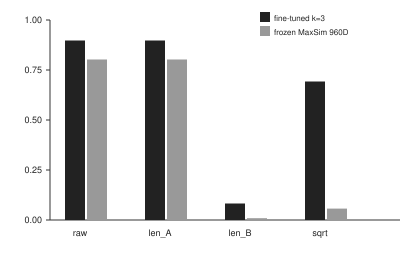
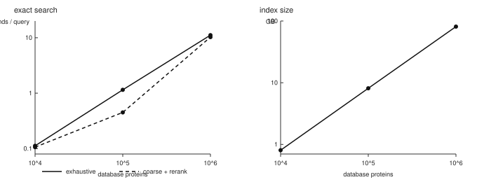
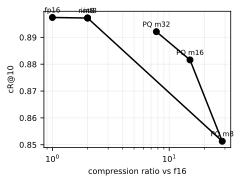

# Scaling Late-Interaction Protein Retrieval: A Practical Index for ESM-C Residue Embeddings

## Abstract

Late-interaction retrieval represents a protein as a set of residue vectors and
scores a pair with MaxSim. ProtoCol [1] showed that this idea is
sensitive for protein homolog search, but it deferred efficient search over
large databases. We ask whether the idea survives deployment: full-length
chains, database sizes where pooling and alignment baselines stop being the
only practical option, and an index that runs locally. We use ESM-C
300M [2] with a learned projection and a partially
fine-tuned backbone. On SCOPe
ASTRAL40 [3] the fine-tuned scorer reaches cR@10
0.9065 ± 0.0014, compared with 0.8933 for a
reproduced ProtoCol, 0.6304 for frozen ESM-C MaxSim, and
0.4045 for mean-pooled ESM-C. On a deployment-shaped corpus of
100,000 full-length Swiss-Prot chains [4], it reaches
0.8974 cR@10 versus 0.8304 for MMseqs2,
with a larger gap in sensitivity at superfamily level
(0.6048 versus
0.4765). Exact search costs
0.999 s/query at 100,000 proteins and
11.134 s/query at 1,000,000 on an Apple M4 Max laptop;
the index is 8.14 GB and 81.17 GB respectively, and
build time is 1.79 h and 17.49 h. Build
and storage, not query search, are the wall. Compression and coarse reranking
do not pay off in this regime. We release an offline package and the measured
system.

## Introduction

Protein sequence databases are large, and the retrieval question is simple:
given a query sequence, return the proteins that share its homology or
function. Alignment methods such as BLAST [5] and MMseqs2 [6] are
strong and fast. Dense retrieval methods summarize a protein as one vector
[7] [8] [9], or compare residue representations with an
alignment-like aggregation [10] [11] [12]. Late interaction
sits between these extremes: it keeps one vector per residue and scores a pair
with MaxSim, the sum over query residues of the best match in the candidate.
ColBERT [13] made this practical for text; ProtoCol [1] brought
it to protein homolog search and showed a sensitivity advantage over pooled
ESM-2 embeddings and MMseqs2 on small SCOPe and Pfam test sets.

ProtoCol left the systems question open. Its evaluation used short domains,
truncated sequences to a few hundred residues, and test sets of a few thousand
proteins. The model idea is theirs. This paper asks the next question: does
late-interaction protein retrieval survive a real database, and what does it
cost? We make four contributions.

- **A deployment-shaped benchmark.** We evaluate on
  100,000 full-length Swiss-Prot chains with 500
  clan-disjoint queries, including 239 chains longer than
  the ESM-C context window. This is closer to what a user indexes than a set of
  short domains.
- **A backbone and training study.** Frozen ESM-C is weaker than frozen ESM-2
  35M under the same harness (0.6304 versus
  0.8215 cR@10). The ESM-C upgrade requires fine-tuning; a
  3-block suffix plus a 128-dimensional head recovers
  and exceeds the reproduced ProtoCol on SCOPe.
- **An exact index and measured systems.** We store projected residue rows in a
  single memory-mapped `.esmci` file, search with tiled GEMM plus a fused Metal
  max kernel, and measure exact search from
  10,000 to 1,000,000 proteins. We also report where
  compression and coarse retrieval stop helping.
- **Software.** The `esmc-retrieval` package builds, saves, loads, and searches
  an index offline through a small `ProteinIndex` API.

## Related work

**Late interaction.** ColBERT [13] introduced contextualized late
interaction for text. PLAID [14], MUVERA [15], and DESSERT [16]
made multi-vector retrieval efficient, and PyLate [17] provides a modern
training and retrieval stack. ProtoCol [1] is the direct prior work for
proteins: it trains a residue-level projection with a symmetric contrastive
objective and evaluates capped recall on SCOPe and Pfam. We reuse that model
idea and cite it as such; our contribution is the deployment-shaped benchmark,
the ESM-C backbone study, and the index/search measurements.

**Dense protein retrieval.** DHR [7] trains a dual encoder for homolog
detection. TM-Vec and DeepBLAST [9] predict structural similarity and
alignment from protein language model embeddings. PLMSearch and PLMAlign
[10] use residue embeddings with a learned similarity head and an
alignment stage. pLM-BLAST [11] and PEbA [12] compare residue
representations directly. knnProtT5 [8] is the mean-pooled
nearest-neighbor baseline that motivates our pooled control. These methods are
not interchangeable with ours: they use different backbones, splits, and
metrics. We therefore cite them as related work rather than quoting their
numbers next to ours.

**Structure and scale.** Foldseek [18] searches structures and is the
natural comparison when structures exist; we evaluate sequences only. ERAST
[19] targets billion-scale vector search with a hosted database. Our
systems claim is deliberately smaller and exact: a local index whose search
cost we measure.

**Sequence baselines.** MMseqs2 [6] and BLAST [5] are the
alignment baselines. MinHash over k-mers [20] is a cheap sketch baseline
in the spirit of ProtoCol's comparison. These are the only external retrieval
methods we run end to end; all other comparisons are left to future work.

## Method

### Representation and scorer

ESM-C 300M [2] maps a sequence to one vector per residue.
We take the final
layer, apply a linear projection from H=960 to D=128, and
L2-normalize each projected residue row. For a query A and candidate B,
MaxSim is

    S(A, B) = sum_{i in A} max_{j in B} a_i . b_j.

We use the raw sum. Dividing by the query length is rank-invariant within a
query and affects only calibration; dividing by the candidate length or by the
geometric mean of the two lengths changes the ranking and is evaluated as an
ablation. ESM-C's context is 2048 tokens; residues are packed into
windows of 2046 with 128 overlap, and the
overlap rows are emitted once. The resulting row count equals the sequence
length exactly. A residue may match any residue in the candidate; chunk
identity is dropped at scoring time.

### Training

The projection is trained with symmetric InfoNCE [21] over MaxSim, using
in-batch negatives. We use temperature 1, batch
16, and 3 epochs; the temperature is swept
rather than inherited from the vision-language default [22]. We mask false
negatives:
an in-batch pair that shares the positive's superfamily is removed from the
denominator. This is a small correctness fix over ProtoCol's unfiltered
in-batch objective. The first phase freezes ESM-C and trains only the
projection. The second phase fine-tunes the last 3 transformer
blocks and the final layer norm with the projection, using a smaller learning
rate for the backbone (2e-05) than for the head
(0.001). Training pairs are same-superfamily SCOPe domains;
selection uses only the validation split. The test split is evaluated once
after selection. We use 3 seeds and report mean and
population standard deviation.

### Index and search

The index stores the projected residue rows as half-precision values in a
single file: a fixed header, one offset per protein, and a packed payload.
Metadata lives in a JSON sidecar. Inference runs through `esmc.cpp`
[23]. Loading is a memory map; opening the
100,000-protein index takes milliseconds. Search is exact: tile the
query against the database rows, keep a running maximum per candidate, and
return the top list. On Apple Silicon the max is fused into the Metal kernel so
the similarity matrix never leaves the GPU. A numpy path is the fallback. The
optional coarse stage pools each protein into one vector, retrieves C
candidates, and reranks them with exact MaxSim.

## Experimental setup

**SCOPe.** We use SCOPe ASTRAL40: 15,177 domains split by
superfamily into 9,894 / 875 / 2,314 train/val/test. The test set has
2,314 domains. The maximum train/test identity over
alignments covering at least eighty percent of both sequences is
38.2%. Queries are the test rows themselves; the corpus is
the split, and the query is excluded from its own ranking. Relevance is the
shared superfamily, following ProtoCol's capped recall.

**Full-length Swiss-Prot.** We build a corpus of 100,000
single-clan reviewed chains, with 500 queries drawn
round-robin from 113 test clans. Queries are rows of the
corpus and are scored leave-one-out, so the frozen evaluation harness applies
unchanged. 239 chains exceed the residue window; the longest
is 14,507 amino acids. Train, validation, and test clans are
disjoint.

**Scaling.** For systems measurements we use UniRef50 [24] subsets of
10,000, 100,000, and 1,000,000 proteins. These
measure build, storage, and search, not retrieval quality: the larger subsets
do not have complete homology labels.

**Baselines.** MMseqs2 is run with the settings that reproduce ProtoCol's
published comparison. MinHash uses short k-mers and a fixed sketch budget.
Pooled ESM-C is
the mean of the residue rows with cosine similarity. Frozen MaxSim uses the
same ESM-C rows without training, at H and at a random D projection. ProtoCol
is reproduced from its released code on our split. FAISS flat on pooled vectors
[25] is a latency floor, not a quality baseline. We report capped recall at
several cutoffs, MRR, and sensitivity to the first false positive at family,
superfamily, and fold level.

**Hardware.** All measurements are on an Apple M4 Max laptop with Metal and a
CPU fallback. We do not claim GPU-server numbers.

## Results

### SCOPe: training is necessary, and it beats the reproduced baseline

Table 2 is the main domain result. Frozen ESM-C MaxSim is far ahead of pooled
ESM-C (0.6304 versus 0.4045 cR@10) but still
behind the reproduced ProtoCol. A trained projection closes most of the gap:
0.8574 ± 0.0023. Fine-tuning the last 3 blocks closes the
rest: 0.9065 ± 0.0014, above the reproduced ProtoCol
(0.8933) and far above MMseqs2
(0.6179). The sensitivity numbers tell the same story: at
superfamily level the fine-tuned model reaches
0.5566 ± 0.0058, versus 0.2402 for
MMseqs2. ProtoCol's released evaluator does not report sensitivity; its capped
recall is 0.8933.

**Table 2. SCOPe ASTRAL40 retrieval (n=2314)**

| Method | cR@1 | cR@5 | cR@10 | cR@100 | MRR | sens family | sens superfamily | sens fold |
|---|---|---|---|---|---|---|---|---|
| Random | 0.0389 | 0.0445 | 0.0454 | 0.0615 | 0.1192 | 0.0008 | 0.0007 | 0.0005 |
| MinHash 5-mer | 0.3254 | 0.2242 | 0.1956 | 0.1624 | 0.4333 | 0.0356 | 0.0182 | 0.0155 |
| MMseqs2 | 0.8578 | 0.7100 | 0.6179 | 0.3424 | 0.8695 | 0.1753 | 0.2402 | 0.2166 |
| Pooled ESM-C | 0.6089 | 0.4640 | 0.4045 | 0.3313 | 0.6848 | 0.0834 | 0.0756 | 0.0671 |
| Frozen MaxSim 960D | 0.8678 | 0.7182 | 0.6304 | 0.4817 | 0.8937 | 0.1770 | 0.2264 | 0.2029 |
| Frozen MaxSim 128D | 0.8297 | 0.6603 | 0.5717 | 0.4391 | 0.8620 | 0.1636 | 0.1903 | 0.1695 |
| ProtoCol frozen (reproduced) | 0.8829 | 0.8335 | 0.8096 | 0.7421 | — | — | — | — |
| ProtoCol trained (reproduced) | 0.9447 | 0.9064 | 0.8933 | 0.8771 | — | — | — | — |
| ESM-C + trained head (M2) | 0.9549 ± 0.0014 | 0.8965 ± 0.0012 | 0.8574 ± 0.0023 | 0.7502 ± 0.0072 | 0.9654 ± 0.0007 | 0.2305 ± 0.0011 | 0.4369 ± 0.0012 | 0.4051 ± 0.0022 |
| ESM-C fine-tuned k=3 (M3) | 0.9705 ± 0.0010 | 0.9305 ± 0.0020 | 0.9065 ± 0.0014 | 0.8329 ± 0.0034 | 0.9765 ± 0.0006 | 0.2426 ± 0.0019 | 0.5566 ± 0.0058 | 0.5275 ± 0.0069 |

Leave-one-out; cR@k is ProtoCol's capped recall. M2/M3 are mean ± population std over 3 seeds; all other rows are single runs. ProtoCol's released evaluator reports only capped recall.

The backbone control is Table 2b. Frozen ESM-C is not a drop-in replacement for
a smaller frozen ESM-2: on the same harness, frozen ESM-2 35M reaches
0.8215 cR@10 versus 0.6304 for frozen
ESM-C. The ESM-C gain appears only after fine-tuning. This is a useful negative
result: a stronger backbone does not remove the need for task training.

**Table 2b. Frozen backbone control**

| Backbone | cR@10 | sens superfamily | sens fold |
|---|---|---|---|
| Frozen ESM-C 300M | 0.6304 | 0.2264 | 0.2029 |
| Frozen ESM-2 35M (full) | 0.8215 | 0.5004 | 0.4825 |
| Frozen ESM-2 35M (ProtoCol protocol) | 0.8172 | 0.4890 | 0.4706 |

Same harness and test split; no projection training. The ESM-2 35M rows are the M1 protocol-gap diagnostic.

### Full-length chains: the deployment-shaped result

Table 3 is the result that matters for users. On 100,000
full-length chains, the fine-tuned scorer reaches
0.8974 cR@10 versus 0.8304 for MMseqs2 and
0.8024 for frozen MaxSim. The gap widens for the stricter
sensitivity metric: 0.6048 versus
0.4765 at superfamily level and
0.7557 versus 0.7065 at family
level. Pooling loses most of the signal (0.6870 cR@10), and
MinHash is weaker still (0.5957). This is the main scientific
claim: residue-level late interaction is not only a domain benchmark artifact;
it survives full-length chains and a clan-disjoint corpus.

**Table 3. Full-length Swiss-Prot 100K retrieval**

| Method | cR@1 | cR@5 | cR@10 | cR@100 | MRR | sens family | sens superfamily |
|---|---|---|---|---|---|---|---|
| Random | 0.0020 | 0.0048 | 0.0040 | 0.0048 | 0.0183 | 0.0000 | 0.0000 |
| MinHash 5-mer | 0.8180 | 0.6756 | 0.5957 | 0.4092 | 0.8273 | 0.3299 | 0.2067 |
| MMseqs2 | 0.9540 | 0.8779 | 0.8304 | 0.6612 | 0.9542 | 0.7065 | 0.4765 |
| Pooled ESM-C | 0.8880 | 0.7544 | 0.6870 | 0.4643 | 0.8990 | 0.3213 | 0.2118 |
| Frozen MaxSim 960D | 0.9500 | 0.8528 | 0.8024 | 0.6355 | 0.9548 | 0.5854 | 0.3914 |
| Frozen MaxSim 128D | 0.9100 | 0.7985 | 0.7374 | 0.5530 | 0.9190 | 0.4862 | 0.3091 |
| ESM-C fine-tuned k=3 | 0.9780 | 0.9252 | 0.8974 | 0.8172 | 0.9792 | 0.7557 | 0.6048 |

100,000 single-clan chains; 500 test-clan queries; leave-one-out; raw MaxSim for the vector scorers.

### Length bias: real but mild; do not normalize the candidate length

The suspected confound is that MaxSim grows with candidate length because a
longer candidate offers more chances for a high-scoring match. We measure it
directly. On the full-length corpus the Spearman correlation between candidate
length and score over non-homolog pairs is
0.172 for the fine-tuned scorer and
0.069 for frozen MaxSim. That is mild. Raw scoring wins:
dividing by the query length is rank-invariant, while dividing by the candidate
length collapses cR@10 from 0.8974 to
0.0825, and the geometric-mean variant also loses
(0.6926). We therefore keep the raw sum. The measurement
matters more than a correction: the length prior is not strong enough to
explain the retrieval quality, and candidate-length normalization is worse than
doing nothing.

**Table 4. Length-normalization ablation**

| Method | Normalization | cR@10 | sens superfamily | rho(len, score) |
|---|---|---|---|---|
| ESM-C fine-tuned k=3 | raw | 0.8974 | 0.6048 | 0.172 |
| ESM-C fine-tuned k=3 | ÷ len_A | 0.8974 | 0.6048 | 0.172 |
| ESM-C fine-tuned k=3 | ÷ len_B | 0.0825 | 0.0054 | 0.172 |
| ESM-C fine-tuned k=3 | ÷ sqrt(len_A len_B) | 0.6926 | 0.3010 | 0.172 |
| Frozen MaxSim 960D | raw | 0.8024 | 0.3914 | 0.069 |
| Frozen MaxSim 960D | ÷ len_A | 0.8024 | 0.3914 | 0.069 |
| Frozen MaxSim 960D | ÷ len_B | 0.0090 | 0.0000 | 0.069 |
| Frozen MaxSim 960D | ÷ sqrt(len_A len_B) | 0.0570 | 0.0101 | 0.069 |

Full-length 100K corpus. div_lenA is rank-invariant within a query; the candidate-length variants change the ranking.

*Figure 3. Length normalization on the full-length corpus. Raw and query-length
normalization are rank-equivalent; candidate-length normalization destroys the
ranking.*

### Ablations: dimension, temperature, masking, and depth

Table 5a shows the projection dimension. D=128 is the default:
0.8493 ± 0.0010 validation cR@10 at 256 bytes per
residue. D=64 is smaller but weaker, and D=256 buys
0.8602 ± 0.0027 for twice the index. Table 5b shows that masking wins at
every temperature; temperature itself is a flat knob in this range. Table 5c
shows that three fine-tuned blocks beat two
(0.8790 ± 0.0031 versus 0.8703 ± 0.0004 validation cR@10), and the
selected model reaches 0.9065 ± 0.0014 on test.

**Table 5a. Projection dimension (val)**

| D | val cR@10 | bytes/residue (fp16) |
|---|---|---|
| D=64 | 0.8222 ± 0.0029 | 128 |
| D=128 | 0.8493 ± 0.0010 | 256 |
| D=256 | 0.8602 ± 0.0027 | 512 |

Mean ± population std over 3 seeds, selected on scope_val only.

**Table 5b. Temperature and false-negative masking (val)**

| tau | masked | val cR@10 |
|---|---|---|
| 0.03 | yes | 0.8489 ± 0.0024 |
| 0.03 | no | 0.8480 ± 0.0027 |
| 0.1 | yes | 0.8468 ± 0.0023 |
| 0.1 | no | 0.8462 ± 0.0015 |
| 0.3 | yes | 0.8487 ± 0.0033 |
| 0.3 | no | 0.8477 ± 0.0015 |
| 1 | yes | 0.8493 ± 0.0010 |
| 1 | no | 0.8476 ± 0.0025 |

Mean ± population std over 3 seeds. Masking removes in-batch pairs sharing the positive's superfamily from the denominator.

**Table 5c. Fine-tuned blocks (val and test)**

| k | val cR@10 | test cR@10 |
|---|---|---|
| k=2 | 0.8703 ± 0.0004 | — |
| k=3 | 0.8790 ± 0.0031 | 0.9065 ± 0.0014 |

Mean ± population std over 3 seeds. Test is evaluated once after val selection; k=2 test was not evaluated.

### Systems: exact search is practical to a million, build is the wall

Table 6a is the systems result. At 100,000 proteins, exact search costs
1.150 s/query; at 1,000,000 it costs
11.134 s/query. The index is 8.14 GB and
81.17 GB. Build time is 1.79 h and
17.49 h. Opening an index is milliseconds, so the interactive
cost is query embedding plus search, not load. On one hundred thousand proteins
the fused Metal path reaches 0.999 s/query
(1.001 q/s), versus 2.536 s/query on the
CPU and 1.774 on MPS. The CPU path is already near the GEMM roofline
(91.7 percent); the GPU win comes from fusing the max and
avoiding the score-matrix write.

**Table 6a. Exact search and coarse stage, 10K–1M**

| n_db | residues | index GB | build h | open ms | exhaustive s/q | q/s | C | candidate recall | coarse s/q | speedup |
|---|---|---|---|---|---|---|---|---|---|---|
| 10,000 | 3,151,934 | 0.81 | 0.17 | 6.5 | 0.112 | 8.905 | 3,000 | 0.994 | 0.106 | 1.1 |
| 100,000 | 31,787,100 | 8.14 | 1.79 | 7.8 | 1.150 | 0.869 | 10,000 | 0.996 | 0.450 | 2.6 |
| 1,000,000 | 317,031,935 | 81.17 | 17.49 | 6.0 | 11.134 | 0.0898 | 30,000 | 0.994 | 10.261 | 1.1 |

M4 Max, fused Metal, 50 queries. Build/index from UniRef50 subsets; coarse stage reranks C candidates with exact MaxSim.

**Table 6b. Search backends at 100K (PyLate at 1K)**

| Backend | n_db | q/s | s/query | index MB | GEMM eff % |
|---|---|---|---|---|---|
| numpy CPU | 100,000 | 0.394 | 2.536 | 8717.9 | 91.7 |
| MPS | 100,000 | 0.564 | 1.774 | 8717.9 | 43.7 |
| Metal (fused) | 100,000 | 1.001 | 0.999 | 8717.9 | — |
| FAISS flat (pooled) | 100,000 | 7,559 | 0.00014 | 51.2 | — |
| PyLate/PLAID | 1,000 | 23.4 | 0.0427 | 16.4 | — |

CPU/MPS/Metal are exact MaxSim. FAISS is an approximate latency floor over pooled vectors, not a quality-comparable retriever. PyLate/PLAID is 1K only because full-DB encoding was infeasible here.

*Figure 1. Exact search and index size versus database size. The
million-protein point is measured; beyond it we do not extrapolate a promise.*

The coarse stage is Table 8. It recovers
0.994 of the exhaustive top-10 candidate set at
30,000 candidates on one million proteins, but costs
10.261 s/query against 11.134 for
exhaustive: only 1.1x. The rerank gathers candidates at
random from an 81.17 GB index, so the gather dominates. Coarse
retrieval is therefore not shipped as a default. It is the right direction for
a future layout, not a measured win here.

**Table 8. Coarse candidate stage vs exhaustive**

| n_db | C | candidate recall | coarse s/q | exhaustive s/q | rerank agreement | speedup |
|---|---|---|---|---|---|---|
| 10,000 | 3,000 | 0.994 | 0.106 | 0.112 | 0.94 | 1.1 |
| 100,000 | 10,000 | 0.996 | 0.450 | 1.150 | 0.98 | 2.6 |
| 1,000,000 | 30,000 | 0.994 | 10.261 | 11.134 | 0.94 | 1.1 |

Candidate recall is recall of the exhaustive top-10 candidate set. At 1M, random candidate gather makes rerank almost exhaustive.

### Compression: the recall bar is reachable, the latency bar is not

Table 7 reports compression on the full-length index. Integer quantization is
only a factor of two smaller, below our size bar. Product quantization reaches
a factor of 7.76 at a cR@10 drop of 0.0052
(0.8921), which passes the recall bar, but decode plus MaxSim was
slower than reading half-precision rows. We keep the uncompressed index and
report the negative result. A fused decode-and-max kernel is the obvious next
step; it is not part of this paper's claim.

**Table 7. Compression trade-off (100K full-length)**

| Scheme | ratio vs f16 | cR@10 | drop cR@10 | pass |
|---|---|---|---|---|
| fp16 | 1.00 | 0.8974 | 0.0000 | no |
| int8 | 2.00 | 0.8972 | 0.0002 | no |
| residual int8 | 2.00 | 0.8972 | 0.0002 | no |
| residual PQ m8 | 28.43 | 0.8513 | 0.0461 | no |
| residual PQ m16 | 15.06 | 0.8816 | 0.0158 | no |
| residual PQ m32 | 7.76 | 0.8921 | 0.0052 | yes |

Pass = >=4x smaller and cR@10 drop <=0.01. Only PQ m32 passes; it was not shipped because decode+MaxSim was slower than f16.

*Figure 2. Compression trade-off. Passing the recall bar is not enough; the
decode path must also beat reading the raw rows.*

### Package

The package exposes `ProteinIndex.from_fasta`, `build`, `load`, `search`, and
`search_batch`, plus a CLI. A fresh install builds and searches a small SCOPe
index offline; the release smoke retrieves the same superfamily in
10 of 1,000 top-1 results. Table 9 profiles
the runtime. At one thousand proteins, Metal search is
19.0 ms/query; at one hundred thousand it is
1.29 s/query. The million-protein numpy path is
67.05 s/query, which is why the systems claim is
batch-mode at that size. The index is not self-contained: the matching head and
fine-tuned GGUF must travel with it, and the sidecar records their hashes.

**Table 9. Package profile (appendix)**

| Index / backend | encode ms/q | search ms/q | search s/q | q/s |
|---|---|---|---|---|
| 1K numpy | 122.7 | 16.3 | 0.02 | 7.192 |
| 1K Metal | 61.5 | 19.0 | 0.02 | 12.4 |
| 100K numpy | 113.7 | 9057.8 | 9.06 | 0.109 |
| 100K Metal | 112.5 | 1294.0 | 1.29 | 0.711 |
| 1M numpy | 308.5 | 67051.5 | 67.05 | 0.015 |

M4 Max. Single-query encode+search; model/context stays loaded. The 1M row is numpy (no Metal backend at that size in M8).

**Table 9b. Offline package smoke**

| Index | Queries | top-1 superfamily | top-1 family |
|---|---|---|---|
| SCOPe 1K | 1,000 | 10 | 8 |

Fresh-install smoke from the M8 release check.

## Discussion and limitations

The result is a practical exact index, not a new retrieval model. ProtoCol
introduced the model idea; we show that it survives full-length chains and that
its exact search is usable at a hundred thousand proteins on a laptop and
batch-usable at a million. The negative results are part of the contribution:
frozen ESM-C is weaker than frozen ESM-2, length normalization hurts, coarse
reranking does not pay off at a million with a random gather, and compression
that passes recall can still lose on latency.

The limits are equally clear. We did not run DHR, TM-Vec, PLMSearch, pLM-BLAST,
ERAST, or Foldseek end to end, so we do not claim a head-to-head win against
them. We did not evaluate Pfam retrieval. The identity control is one ASTRAL40
filter; we do not report ten, twenty, or thirty percent subsets. The full-length
experiment uses one corpus and one seed for the deployment number; the SCOPe
result is the three-seed result. The systems measurements are Apple Silicon
only. The million-protein point has systems measurements, not labeled retrieval
quality. Ten million proteins would need roughly a machine-week of build time
and an index larger than the machine's memory; we did not run it, and we do not
claim it. Finally, the package's million-protein path falls back to numpy;
Metal is not claimed there.

## Conclusion

Late-interaction protein retrieval is practical when the representation is
fine-tuned, the index is exact, and the target is a local database. On SCOPe the
fine-tuned ESM-C scorer is slightly above a reproduced ProtoCol and far above
pooled and alignment baselines. On full-length Swiss-Prot it is clearly above
MMseqs2 at the sensitivity metrics that matter for remote relations. Exact
search costs about a second per query at a hundred thousand proteins and about
eleven seconds at a million, with build and storage as the real constraints. The
code, model, and index format are released so the next experiment can be a
better index rather than a reimplementation.

## Appendix A. Reproducibility

All paper numbers are generated from `paper/results.lock.json`, a hash-pinned
projection of `results/runs.jsonl` at a recorded commit. `make tables`
regenerates every table and data figure without the model, the embedding cache,
the network, or `esmc.cpp`. `make claims` regenerates this audit; `make audit`
checks that every numeric sentence maps to a table cell and that every citation
is verified. The fine-tuned GGUF and projection head are published separately
from the package and are hash-checked at load time. The SCOPe and Swiss-Prot
source files, split hashes, and model hashes are recorded in
`data/manifest.json` and `data/fulllength/manifest.json`. The model weights are
governed by the Cambrian Open License [26]; the runtime is MIT.

## References

1. Cohn, G. et al. *PROTOCOL: Late Interaction Retrieval for Protein Homolog Search*. arXiv:2605.29158, 2026. https://arxiv.org/abs/2605.29158
2. EvolutionaryScale. *ESM-C 300M (ESM Cambrian) model card*. Hugging Face, 2024. https://huggingface.co/EvolutionaryScale/esmc-300m-2024-12
3. SCOPe Consortium. *SCOPe 2.08 ASTRAL 40% domain sequences*. Structural Classification of Proteins extended, 2026. https://scop.berkeley.edu/downloads/scopeseq-2.08/astral-scopedom-seqres-gd-sel-gs-bib-40-2.08.fa
4. UniProt Consortium. *UniProtKB/Swiss-Prot reviewed sequences*. UniProt, 2026. https://www.uniprot.org/
5. Altschul, S. F., Gish, W., Miller, W., Myers, E. W., Lipman, D. J. *Basic local alignment search tool*. Journal of Molecular Biology 215, 403-410, 1990. https://doi.org/10.1016/S0022-2836(05)80360-2
6. Steinegger, M. and Soding, J. *MMseqs2 enables sensitive protein sequence searching for the analysis of massive data sets*. Nature Biotechnology 35, 1026-1028, 2017. https://www.nature.com/articles/nbt.3988
7. Hong, L. et al. *Fast, sensitive detection of protein homologs using deep dense retrieval*. Nature Biotechnology 43, 983-995, 2024. https://www.nature.com/articles/s41587-024-02353-6
8. Schutze, K., Heinzinger, M., Steinegger, M., Rost, B. *Nearest neighbor search on embeddings rapidly identifies distant protein relations*. Frontiers in Bioinformatics 2, 1033775, 2022. https://www.frontiersin.org/journals/bioinformatics/articles/10.3389/fbinf.2022.1033775/full
9. Hamamsy, T. et al. *Protein remote homology detection and structural alignment using deep learning*. Nature Biotechnology 42, 975-985, 2024. https://www.nature.com/articles/s41587-023-01917-2
10. Liu, W. et al. *PLMSearch: Protein language model powers accurate and fast sequence search for remote homology*. Nature Communications 15, 2775, 2024. https://www.nature.com/articles/s41467-024-46808-5
11. Kaminski, K. et al. *pLM-BLAST: distant homology detection based on direct comparison of sequence representations from protein language models*. Bioinformatics 39, btad579, 2023. https://pubmed.ncbi.nlm.nih.gov/37725369
12. Iovino, L. and Ye, Y. *Protein embedding based alignment*. BMC Bioinformatics 25, 85, 2024. https://link.springer.com/article/10.1186/s12859-024-05699-5
13. Khattab, O. and Zaharia, M. *ColBERT: Efficient and Effective Passage Search via Contextualized Late Interaction over BERT*. SIGIR 2020, 2020. https://arxiv.org/abs/2004.12832
14. Santhanam, K., Khattab, O., Potts, C., Zaharia, M. *PLAID: An Efficient Engine for Late Interaction Retrieval*. CIKM 2022, 2022. https://dl.acm.org/doi/10.1145/3511808.3557325
15. Dhulipala, L., Hadian, M., Jayaram, S., Lee, A., Mirrokni, V. *MUVERA: Multi-Vector Retrieval via Fixed Dimensional Encodings*. NeurIPS 2024, 2024. https://arxiv.org/abs/2405.19504
16. Engels, J., Coleman, B., Lakshman, V., Shrivastava, A. *DESSERT: An Efficient Algorithm for Vector Set Search with Vector Set Queries*. NeurIPS 2023, 2023. https://arxiv.org/abs/2210.15748
17. Chaffin, A. and Sourty, S. *PyLate: Flexible Training and Retrieval for Late Interaction Models*. CIKM 2025, 2025. https://arxiv.org/abs/2508.03555
18. van Kempen, M. et al. *Fast and accurate protein structure search with Foldseek*. Nature Biotechnology 42, 243-246, 2024. https://www.nature.com/articles/s41587-023-01773-0
19. Jiang, Y., He, B., Yao, J. et al. *Scalable homology detection with ERAST*. Nature Biotechnology, 2026. https://www.nature.com/articles/s41587-026-03051-1
20. Zhu, E. *datasketch: MinHash and LSH implementation*. GitHub, 2024. https://github.com/ekzhu/datasketch
21. van den Oord, A., Li, Y., Vinyals, O. *Representation Learning with Contrastive Predictive Coding*. arXiv:1807.03748, 2018. https://arxiv.org/abs/1807.03748
22. Radford, A. et al. *Learning Transferable Visual Models From Natural Language Supervision*. ICML 2021, 2021. https://arxiv.org/abs/2103.00020
23. Pathak, A. and Pathak, A. *esmc.cpp: A Zero-Dependency, Metal-Accelerated C/C++ Runtime for ESM Cambrian Protein Embeddings*. OpenReview (CAISc 2026, non-archival), 2026. https://openreview.net/forum?id=0GarVDrEAi
24. UniProt Consortium. *UniRef50 protein clusters*. UniProt, 2026. https://www.uniprot.org/uniref
25. Johnson, J., Douze, M., Jegou, H. *Billion-scale similarity search with GPUs*. IEEE Transactions on Big Data, 2019. https://github.com/facebookresearch/faiss
26. EvolutionaryScale. *EvolutionaryScale Cambrian Open License Agreement*. EvolutionaryScale policy, 2026. https://www.evolutionaryscale.ai/policies/cambrian-open-license-agreement

